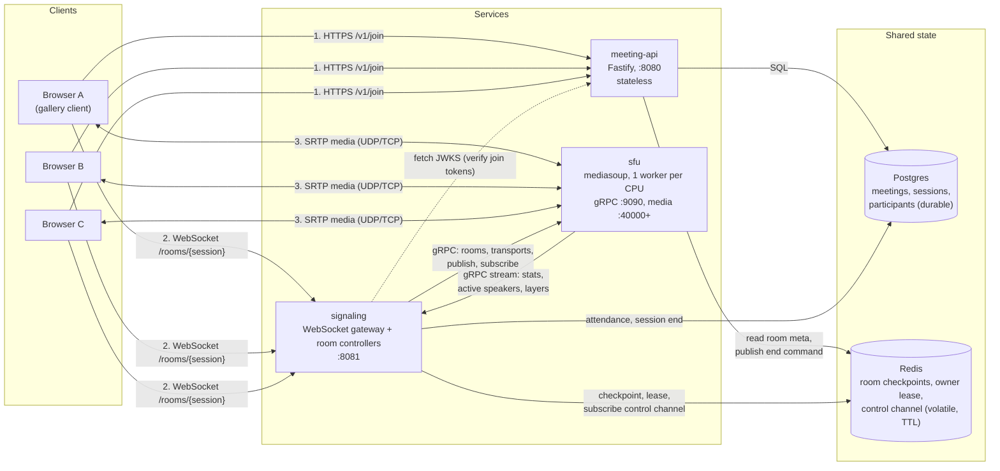
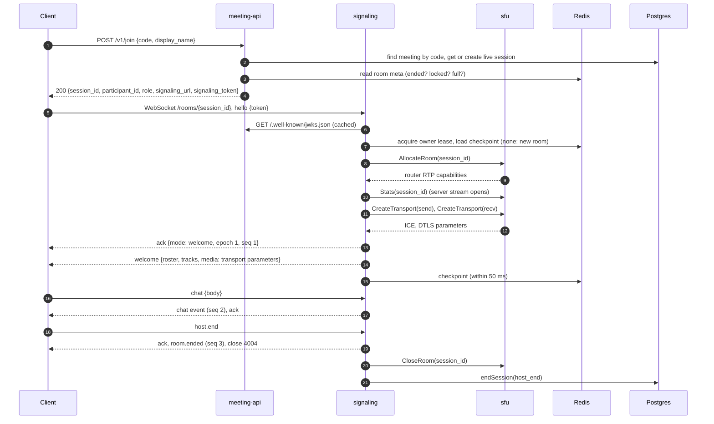

# ZoomClone: system report

A multi-party video meeting backend (the Google Meet / Zoom class of system described in
`video-meeting-backend-spec.pdf`), built as three communicating services plus a browser client.
This report covers what the system is for, how it is organized, the assumptions it makes about
its environment, and the first communication flow, traced from a real run.

## 1. System overview

### Purpose

People create a meeting, share its short code (for example `hc1-qel1-bv2`), and join a live call
from a browser: everyone sends one audio and one video stream and receives everyone else's. The
host can hold guests in a waiting room, mute or remove participants, lock the room and end the
meeting. The system also carries the room's live state (who is here, who is speaking, raised
hands, chat, reactions) and keeps a durable record of meetings, sessions and attendance.

The hard part of such a system is not the web API, it is keeping a room consistent while its
members join, drop and reconnect, and moving media between many participants without every
browser sending its stream to every other browser. The design therefore separates three concerns
into three services:

| Concern | Service | Talks to clients over |
| --- | --- | --- |
| Control plane: meetings, codes, who may join, tokens | `meeting-api` | HTTPS (REST, JSON) |
| Room state: roster, lobby, host controls, events | `signaling` | WebSocket (JSON frames) |
| Media plane: receiving and forwarding audio/video | `sfu` | WebRTC (SRTP over UDP/TCP) |

### What exists today

This is the minimum vertical slice of the spec (its sub-projects A, B and C): a single region,
one SFU node, local Postgres and Redis. Recording, breakout rooms, cross-region cascading,
Kafka and Kubernetes are later slices; the interfaces for them are left in place but not built.
The slice is a working product, not only a skeleton: 321 unit and integration tests, nine
browser end-to-end scenarios (three-party call, lobby, host controls, active speaker, simulcast
layers, reconnect, signaling restart, idle end, join errors), verified on Windows and Linux.

## 2. Architecture diagram



Plain-text version:

```
   browsers (clients)
   |  HTTPS /v1           | WebSocket /rooms/{id}            | SRTP media (UDP/TCP)
   v                      v                                  v
 meeting-api  <-JWKS--  signaling  --gRPC unary calls-->   sfu (mediasoup)
 (stateless)            (room controllers) <--gRPC Stats stream--
   |      \               |        \
   v       v              v         v
 Postgres  Redis <------ Redis     Postgres
 (durable) (room meta,   (checkpoint, lease,   (attendance,
            end command)  control channel)      session end)
```

## 3. Components

### Clients

- **Browser client ("the gallery")**, `services/signaling/src/dev/client/`. A vanilla TypeScript
  page served by the signaling service at `/dev/` when `DEV_HARNESS=true`. It calls `/v1/join`,
  holds one WebSocket to signaling, and uses mediasoup-client to send its camera and microphone
  to the SFU and receive everyone else's. It reconnects on its own and exposes its state on
  `window.__harness` for the Playwright suite.
- **Smoke client**, `services/signaling/scripts/smoke-client.ts` (`pnpm smoke`). A headless
  client with no media: one HTTP request chain to the meeting API, then a WebSocket session with
  signaling. It exists to show the request and response flow in section 6.

### Servers

**meeting-api** (`services/meeting-api`, Fastify, port 8080). The control plane:

- REST routes under `/v1`: create, read, update and cancel a meeting, end it (`:end`), and
  `/v1/join`, the critical path.
- `/v1/join` rate-limits per client IP and per meeting code, finds the meeting by code, gets or
  creates the live session in one transaction, decides the role (host if the caller organized
  the meeting) and whether the guest must wait in the lobby, and signs a 5-minute ES256 token
  that signaling will accept. It publishes the public key at `/.well-known/jwks.json`.
- Holds no in-memory state between requests, so any number of copies can run side by side.
- For development it can act as its own identity provider (`AUTH_DEV_ISSUER=true`); production
  refuses that setting.

**signaling** (`services/signaling`, `ws`, port 8081). The gateway and the room controllers,
one process with an explicit seam between them:

- The **gateway** accepts WebSockets on `/rooms/{session_id}`, requires a `hello` with a valid
  token within 5 s, validates every frame against the shared schema, enforces ping liveness and
  per-connection limits, and hands each participant to its room's controller through a small
  `ParticipantLink { send, close }` interface.
- A **room controller** per live session owns that room. Its core is `Room`, a pure state
  machine (roster, lobby, tracks, sequence numbers, a replay buffer of the last 500 events or
  60 s); the controller adds the side effects: SFU calls, fan-out to sockets, the Redis
  checkpoint, bus events.
- The **registry** makes sure exactly one controller in the whole deployment owns a room (an
  owner lease in Redis) and rebuilds a room from its Redis checkpoint after a restart.
- A **Postgres writer** records attendance asynchronously, off the message path.

**sfu** (`services/sfu`, mediasoup, gRPC on port 9090, media on ports 40000 and up). The media
plane, a Selective Forwarding Unit:

- One mediasoup worker per CPU core, each with its own UDP/TCP media port. A room lives on one
  worker (a mediasoup router).
- Each participant gets two WebRTC transports (send and receive). Every published track becomes a
  producer; every subscription becomes a consumer. Packets are forwarded, never decoded or
  mixed, so a room costs bandwidth, not transcoding CPU.
- Video is simulcast in three layers (180p, 360p, 720p); each subscriber gets the layer it asks
  for or its bandwidth allows.
- Controlled only by signaling, over a gRPC contract (`proto/sfu/v1/sfu.proto`): unary calls for
  rooms, transports, publish and subscribe, plus a server stream (`Stats`) that reports active
  speakers, layer changes, closed producers and transport state back to the controller.

### Peers

There are no peer-to-peer links. Browsers never connect to each other: media goes browser to SFU
to browser (a star around the SFU, not a mesh). Among the servers, copies of signaling are peers
of each other in one sense only: any of them may own any room, and they coordinate through the
Redis lease rather than by talking directly.

### Shared resources

| Resource | Shared by | Holds | Nature |
| --- | --- | --- | --- |
| Postgres | meeting-api, signaling | meetings, meeting sessions, participants (attendance) | durable, transactional, source of truth |
| Redis | meeting-api, signaling | per-room checkpoint (meta, roster, lobby, tracks, sequence), owner lease, `room:{id}:ctl` command channel | fast, volatile, keys expire after 1 h |
| SFU workers (CPU, ports, bandwidth) | every room placed on the SFU | routers, transports, producers, consumers | per-process, in memory |
| The signing key | meeting-api (signs), signaling (verifies via JWKS) | ES256 key pair | public half served over HTTP |
| `packages/protocol` | every service and the client | message schemas, error and close codes | shared code, one source of truth |

## 4. System model

### Organization: distributed, with centralized coordination per room

The system is **distributed**: three kinds of process on separate ports (and, in production,
separate hosts) that share no memory and cooperate only by exchanging messages (HTTP, WebSocket,
gRPC, Redis commands, SQL). It is **not decentralized**: every room has a single coordinator.

- **Per room, centralized.** One room controller owns a session at a time (enforced by the Redis
  lease) and is the only writer of that room's state; it totally orders the room's events with a
  sequence number. One SFU carries the room's media, in a star topology.
- **Across rooms, partitioned.** Different rooms can live on different signaling processes and,
  with more SFU endpoints configured, on different SFUs, so the load spreads without any room
  needing agreement between nodes.
- **Control plane, replicated and stateless.** Any meeting-api instance answers any request;
  Postgres is the single authority for meeting and session records.

This is the classic leader-per-partition shape: a single writer per room keeps the room simple
and strongly consistent, and partitioning by room is what lets the whole system grow.

### Timing: partially synchronous

The system assumes **partial synchrony**. Messages and processing have no fixed upper bound on
delay, but most of the time delays stay within known limits, and the system uses timeouts to act
on that:

| Timeout | Value | What it decides |
| --- | --- | --- |
| hello deadline | 5 s | a socket that never says hello is closed (4006) |
| ping interval / liveness | 10 s / 30 s | a client silent for three intervals is presumed gone (4000) |
| disconnect grace | 30 s | a dropped participant keeps their seat this long before leaving |
| gRPC call deadline | 10 s | a stuck SFU call fails instead of hanging the room |
| owner lease / heartbeat | 15 s / 5 s | a controller that stops renewing loses the room to another process |
| room idle timeout | 5 min | an empty room ends by itself |

A timeout can be wrong: a slow but alive client is treated as gone and must reconnect, a slow
controller can lose its lease. The design accepts that and makes those false suspicions safe
(reconnect replays or resyncs; a controller that lost its lease stops without writing). Within a
single WebSocket or gRPC connection, delivery is reliable and in order (TCP); across connections
there is no ordering, which is why every room event carries the controller's sequence number and
an `epoch`.

Communication is **asynchronous message passing**: a client request carries an `id` and is
answered by an `ack` or `error` with the same `id` whenever the controller gets to it, while
room events are pushed to everyone independently. Media is fully asynchronous and best effort.

The lease also assumes that clocks on different hosts advance at roughly the same **rate**
(bounded drift); it does not need synchronized clocks.

### Node failures: crash-stop and crash-recovery, not Byzantine

- **Clients** fail by crashing or disappearing (tab closed, laptop asleep). A client that comes
  back within the 30 s grace resumes its seat and receives the events it missed; after that it
  must call `/v1/join` again.
- **signaling** is **crash-recovery**. Room state is checkpointed to Redis within 50 ms of each
  change. When a process dies, its lease expires (15 s), the next process to receive a client for
  that room takes the lease, reloads the checkpoint, bumps the room's `epoch`, reconciles its
  track list against the SFU's live state, and every client gets a full `resync`. This path is
  exercised by an end-to-end test that kills the signaling process mid-call.
- **meeting-api** failures lose nothing: it is stateless; a client retries on another instance.
- **sfu** is **crash-stop** in this slice: if a mediasoup worker dies the process exits, and the
  media state (transports, producers, consumers) is gone. Signaling notices an empty SFU room and
  has every client rebuild its transports and republish when it reconnects. There is no hot
  standby SFU; that is the main single point of failure left in the slice.
- **Byzantine behaviour is out of scope.** Nodes are assumed to follow the protocol. Clients are
  not trusted, though: every frame is schema-validated, roles come only from the signed token,
  host commands are authorized server side, and rate limits bound what one client can do.

### Link failures: omissions and partitions, recovered by reconnect

- A link may drop messages, stall, or break entirely (network change, NAT timeout, partition).
  The system does **not** assume reliable links; it assumes a broken link is eventually detected
  (ping timeout, TCP reset, gRPC deadline) and repaired by reconnecting.
- **Client to signaling.** The client reconnects with backoff (0.5 s up to 5 s) and sends
  `hello {resume_seq, epoch}`. If the server still has every event after `resume_seq` in its
  replay buffer and the epoch matches, it replays them; otherwise it sends a full snapshot. Events
  carry sequence numbers, so a duplicate is recognized and dropped.
- **Signaling to SFU.** Unary calls have a 10 s deadline and a failure leaves the room unchanged
  (transports are created before the roster is touched). The `Stats` stream is reopened after a
  1 s pause when it breaks, and the controller re-reads the full snapshot it starts with.
- **Media.** RTP over UDP tolerates loss by design (the codec conceals it, the SFU adapts layers
  to available bandwidth). Media transports are independent of the signaling socket, so a
  signaling reconnect does not interrupt audio or video.
- **Messages are not corrupted or forged in transit**: TCP checksums, DTLS/SRTP for media, and
  TLS in front of HTTP and WebSocket in a real deployment.

### Storage: durable Postgres, volatile Redis, memory for everything hot

| Store | Assumption | Consequence |
| --- | --- | --- |
| Postgres | durable and transactional; survives restarts | the source of truth for meetings, sessions and attendance; a partial unique index guarantees at most one live session per meeting even under a join storm |
| Redis | fast and usually available, **not** durable; keys expire (1 h, or 60 s after a room ends) | losing Redis loses live room state, never meeting records; checkpoints are written behind by up to 50 ms, which the `epoch` bump covers |
| Process memory | lost on crash | the replay buffer and the SFU's media state; losing them costs a resync or a transport rebuild, not data |

Session end is written by one idempotent function (`endSession`) that both the controller and
the API may call, so two writers cannot disagree about whether and why a session ended.

## 5. Scalability, dependability and resource sharing

### Scalability

- **Horizontal control plane.** meeting-api is stateless; add instances behind a load balancer.
  `TRUST_PROXY=true` keeps the per-IP rate limit correct behind that balancer.
- **Rooms are the unit of partitioning.** Each room has exactly one owner, so signaling scales by
  running more processes: the lease decides who owns what, and rooms never need cross-node
  coordination.
- **SFU instead of mesh.** In a mesh each of *n* participants uploads *n - 1* streams; with an
  SFU each uploads one stream and the SFU fans it out. The SFU forwards packets without decoding,
  so its cost grows with bandwidth, not with transcoding CPU.
- **Vertical SFU scaling.** One mediasoup worker per core, each on its own port, and more SFU
  nodes can be listed in `SFU_ENDPOINTS` (the room's `home_sfu` is recorded when it is created).
- **Simulcast and layer selection** let one sender serve subscribers on very different
  connections without the sender re-encoding for each of them.
- **Bounded state per room.** The replay buffer is capped (500 events or 60 s); departed entries
  expire after 10 min; Redis keys expire.
- **Known limits of this slice:** one SFU per room (a room cannot exceed what one worker can
  forward), a static SFU choice rather than a load-aware scheduler, one region.

### Dependability

- **Availability:** no single signaling process is special (any can take over a room after its
  lease lapses); meeting-api has no state to lose; the client reconnects by itself and media
  keeps flowing through a signaling outage.
- **Reliability and consistency:** a single writer per room plus sequence numbers and epochs
  give every client the same ordered view; idempotent session end and the one-live-session
  index keep the durable record consistent under retries and races.
- **Safety:** a controller that loses its lease stops without writing, so a stale owner cannot
  overwrite the new owner's checkpoint; gRPC failures leave no half-joined participant.
- **Security:** short-lived signed tokens, roles taken only from the token, schema validation of
  every frame, rate limits, production refuses the dev identity provider and the dev page.
- **Evidence:** 321 automated tests and nine browser scenarios, including killing the signaling
  process mid-call, dropping a client socket, and idle expiry.
- **Known gaps:** the SFU has no standby (a crash loses media state until clients rebuild), and
  the lease is not yet fenced (a controller paused past its lease could write one stale
  checkpoint in a window of about 20 s).

### Resource sharing

- **One upstream, many downstreams.** Each participant's camera and microphone are sent once and
  shared by every subscriber in the room through SFU consumers.
- **Per-subscriber adaptation** of the shared stream: each consumer picks its own simulcast layer
  and can be paused independently (for example, a tile that is off screen).
- **Shared hardware.** Rooms share mediasoup workers and CPU cores; the process shares its
  gRPC connection to the SFU across all rooms it owns; each service shares a connection pool to
  Postgres and Redis across all requests.
- **Shared state, one owner.** Redis is shared by every signaling process, but each room's keys
  are written only by the room's current owner (the lease), and the control channel lets the
  meeting API reach whichever process owns a room without knowing which one it is.

## 6. Running skeleton and initial communication flow

### The three communicating processes

| Process | Start | Listens on | Receives from | Sends to |
| --- | --- | --- | --- | --- |
| meeting-api | `pnpm dev` | HTTP 8080 | clients (REST), signaling (JWKS) | Postgres, Redis |
| signaling | `pnpm dev` | HTTP + WebSocket 8081 | clients (WebSocket), sfu (Stats stream) | sfu (gRPC), Redis, Postgres, meeting-api (JWKS) |
| sfu | `pnpm dev` | gRPC 9090, media 40000+ | signaling (gRPC), clients (SRTP) | signaling (Stats stream), clients (SRTP) |

### How to run it and see the messages

```sh
pnpm install
pnpm infra:up                 # Postgres :55432 and Redis :56379 in docker
cp .env.example .env
pnpm db:migrate
LOG_LEVEL=debug pnpm dev      # the three services; debug shows every message between them
pnpm smoke                    # in a second terminal: one scripted client request chain
```

At `LOG_LEVEL=debug` every message between components is logged on both ends, without payloads
(tokens, chat text and media parameters stay out of the log):

| Hop | Logged by | Log line |
| --- | --- | --- |
| client to meeting-api (HTTP) | meeting-api | `incoming request` / `request completed` (method, path, status, time) |
| client to signaling (WebSocket) | signaling | `ws recv` / `ws send` (link, type, request id, seq) |
| signaling to sfu (gRPC) | signaling | `grpc call` / `grpc stream opened` (method, outcome, round trip) |
| sfu from signaling (gRPC) | sfu | `grpc handled` / `grpc stream opened` (method, session, participant, outcome, time) |
| room lifecycle | signaling | `room created`, `room ended` (reason, peak participants) |

Two automated tests fail if this logging stops: `gateway.test.ts` ("logs every frame and SFU
call at debug with ids and types but no token or chat text") and `service.test.ts` in the SFU
("logs each handled call with method, ids and outcome at debug, and no payload blobs").

### The flow, step by step



A browser continues after the `welcome` with `connect_transport`, `publish` (camera and mic),
`subscribe` and `consumer_ready`, after which media flows directly between the browser and the
SFU; the smoke client stops before media so the trace stays short.

### Observed run

The client's side (`pnpm smoke`; tokens masked, long lines cut):

```
client -> meeting-api POST /dev/oidc/token {"sub":"11111111-1111-4111-8111-111111111111","name":"Smoke host"}
meeting-api -> client 200 {"access_token":"<jwt>","token_type":"Bearer","expires_in":3600,...}
client -> meeting-api POST /v1/meetings {"title":"smoke"}
meeting-api -> client 201 {"id":"249bf597-...","code":"hc1-qel1-bv2",...}
client -> meeting-api POST /v1/join {"code":"hc1-qel1-bv2","display_name":"Smoke host"}
meeting-api -> client 200 {"session_id":"440e194b-...","participant_id":"933c280c-...","role":"host","lobby":false,...}
client -> signaling hello {"token":"<jwt>"}
signaling -> client ack {"type":"ack","id":"1","payload":{"mode":"welcome","epoch":1,"seq":1}}
signaling -> client welcome {"participant_id":"933c280c-...","role":"host","epoch":1,"seq":1,"state":"joined",...}
client -> signaling chat {"type":"chat","id":"2","payload":{"body":"hello from the smoke client"}}
signaling -> client chat {"type":"chat","seq":2,"payload":{"from":"933c280c-...","body":"hello from the smoke client",...}}
signaling -> client ack {"type":"ack","id":"2","payload":{}}
client -> signaling host.end {"type":"host.end","id":"3","payload":{}}
signaling -> client ack {"type":"ack","id":"3","payload":{}}
signaling -> client room.ended {"type":"room.ended","seq":3,"payload":{"reason":"host_end"}}
signaling closed the socket: 4004 host_end
```

The same run from the services' side (`LOG_LEVEL=debug pnpm dev`, one line per logged message,
ids shortened). Each gRPC call appears twice, once where it is sent and once where it is handled:

```
17:43:11.784  meeting-api INFO   http request       POST /dev/oidc/token -> 200 (1 ms)
17:43:11.793  meeting-api INFO   http request       POST /v1/meetings -> 201 (4 ms)
17:43:11.800  meeting-api INFO   http request       POST /v1/join -> 200 (6 ms)
17:43:11.805  signaling   DEBUG  ws recv            type=hello id=1
17:43:11.810  sfu         DEBUG  grpc handled       method=AllocateRoom code=OK ms=1 sessionId=440e194b
17:43:11.811  signaling   DEBUG  grpc call          method=AllocateRoom code=OK ms=4
17:43:11.812  sfu         DEBUG  grpc stream opened method=Stats ms=0
17:43:11.812  signaling   DEBUG  grpc stream opened method=Stats ms=1
17:43:11.814  signaling   INFO   room created       sessionId=440e194b
17:43:11.815  sfu         DEBUG  grpc handled       method=CreateTransport code=OK ms=0 sessionId=440e194b participantId=933c280c
17:43:11.816  signaling   DEBUG  grpc call          method=CreateTransport code=OK ms=2
17:43:11.817  sfu         DEBUG  grpc handled       method=CreateTransport code=OK ms=0 sessionId=440e194b participantId=933c280c
17:43:11.818  signaling   DEBUG  grpc call          method=CreateTransport code=OK ms=2
17:43:11.818  signaling   DEBUG  ws send            type=ack id=1
17:43:11.818  signaling   DEBUG  ws send            type=welcome
17:43:11.830  signaling   DEBUG  ws recv            type=chat id=2
17:43:11.830  signaling   DEBUG  ws send            type=chat seq=2
17:43:11.830  signaling   DEBUG  ws send            type=ack id=2
17:43:11.860  signaling   DEBUG  ws recv            type=host.end id=3
17:43:11.860  signaling   DEBUG  ws send            type=ack id=3
17:43:11.860  signaling   DEBUG  ws send            type=room.ended seq=3
17:43:11.862  sfu         DEBUG  grpc handled       method=CloseRoom code=OK ms=0 sessionId=440e194b
17:43:11.863  signaling   DEBUG  grpc call          method=CloseRoom code=OK ms=2
17:43:11.870  signaling   INFO   room ended         sessionId=440e194b reason=host_end peak=1
```

Reading it top to bottom: three HTTP requests to the meeting API (token, create, join), then the
`hello` arrives at signaling, which allocates the room on the SFU, opens the `Stats` stream,
creates the participant's two transports, and only then answers with the `ack` and the
`welcome`. Chat is a request that produces a room event (`seq=2`) and an `ack`; `host.end`
produces `room.ended` (`seq=3`), closes the SFU room and ends the session. The whole join, from
`hello` received to `welcome` sent, took 13 ms on a laptop.
